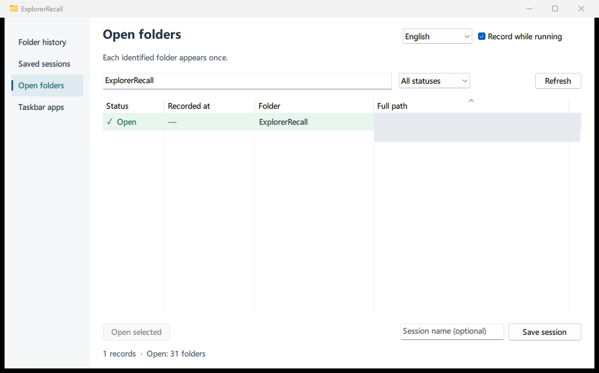

# ExplorerRecall

Fuck Microsoft, 防止 explorer 意外崩溃导致你丢失工作，特别是对于我这种容不得意外的强迫症。

保存并恢复 Windows 文件资源管理器打开的文件夹，也可搜索文件夹历史和任务栏程序记录。原生 C++，支持中文和 English。

**[下载 Windows x64 版](https://github.com/Felix3322/ExplorerRecall/releases/latest/download/ExplorerRecall.exe)**

在 **当前打开** 中保存会话，稍后到 **已保存的会话** 恢复。已打开的路径会跳过。文件夹历史是访问痕迹，不能精确重建过去某一刻的窗口组合。

表格默认每页 128 行，右下角可选择页码或全部；搜索和排序覆盖全部记录。[Windows 会话记录来源](docs/recovery-signals.md)

**构建**：安装 Visual Studio 2022 C++ Build Tools 和 Windows SDK，运行 build.cmd，产物为 bin/ExplorerRecall.exe。

[GPL-3.0-only](LICENSE)
