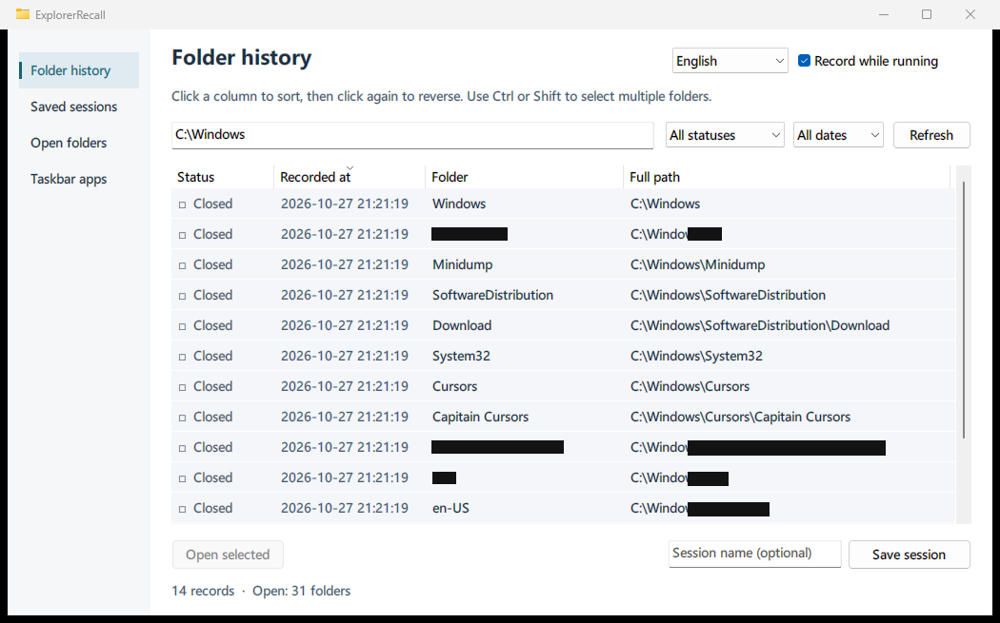
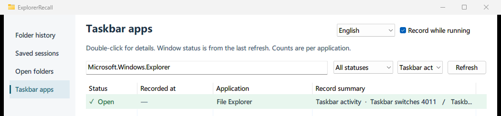

<strong>English</strong> · <a href="README.zh-CN.md">简体中文</a>

# ExplorerRecall

Fuck Microsoft. I wrote this because an Explorer crash shouldn't cost me the folders I was working in.

**[Download for Windows x64](https://github.com/Felix3322/ExplorerRecall/releases/latest/download/ExplorerRecall.exe)**

In **Open folders**, click **Save session** before closing your windows. In **Saved sessions**, click **Restore session** to reopen the missing folders. For automatic snapshots, leave **Record while running** checked. If you have no snapshot, **Folder history** shows folders Windows remembers visiting.

### Windows APIs

| View | Where the data comes from |
|---|---|
| Open folders | `IShellWindows::Item` and `IWebBrowser2::get_Document` enumerate Shell views. `FolderItem::get_Path` reads the folder path. |
| Folder history | `RegEnumKeyExW` and `RegGetValueW` read ShellBags. `SHGetPathFromIDListEx` turns the stored identifiers into paths. The timestamp is the registry key's last update. |
| Taskbar apps | `RegEnumValueW` reads Explorer's FeatureUsage counters and UserAssist records. `EnumWindows`, `GetWindowThreadProcessId` and `QueryFullProcessImageNameW` identify current windows. `IApplicationDocumentLists::GetList` retrieves an app's recent Jump List items. |

**Build:** Run `build.cmd` with Visual Studio 2022 C++ Build Tools and the Windows SDK installed. The executable is `bin\ExplorerRecall.exe`.

[GPL-3.0-only](LICENSE)
