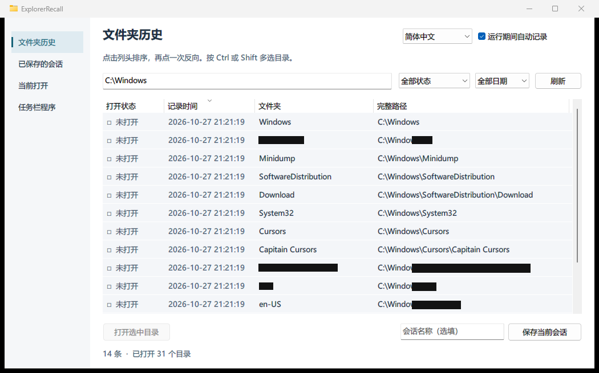

<a href="README.md">English</a> · <strong>简体中文</strong>

# ExplorerRecall

Fuck Microsoft, 防止 explorer 意外崩溃导致你丢失工作，特别是对于我这种容不得意外的强迫症。

**[下载 Windows x64 版](https://github.com/Felix3322/ExplorerRecall/releases/latest/download/ExplorerRecall.exe)**

关窗口前，在 **当前打开** 点 **保存当前会话**。需要找回时，在 **已保存的会话** 点 **恢复整个会话**，工具会补开缺少的目录。勾选 **运行期间自动记录** 可自动保存快照。如果之前没存过，可以到 **文件夹历史** 查找访问过的目录。

### 用到的 Windows API

| 页面 | 数据来源 |
|---|---|
| 当前打开 | `IShellWindows::Item`、`IWebBrowser2::get_Document` 枚举 Shell 视图，`FolderItem::get_Path` 读取文件夹路径。 |
| 文件夹历史 | `RegEnumKeyExW`、`RegGetValueW` 读取 ShellBags，`SHGetPathFromIDListEx` 将保存的标识还原为路径。时间取自注册表键的最后更新时间。 |
| 任务栏程序 | `RegEnumValueW` 读取 FeatureUsage 计数和 UserAssist 记录。`EnumWindows`、`GetWindowThreadProcessId`、`QueryFullProcessImageNameW` 识别当前窗口，`IApplicationDocumentLists::GetList` 查询应用跳转列表中的最近项目。 |

**构建：** 安装 Visual Studio 2022 C++ Build Tools 和 Windows SDK，运行 `build.cmd`，产物为 `bin\ExplorerRecall.exe`。

[GPL-3.0-only](LICENSE) · [Windows 会话记录来源](docs/recovery-signals.md)
